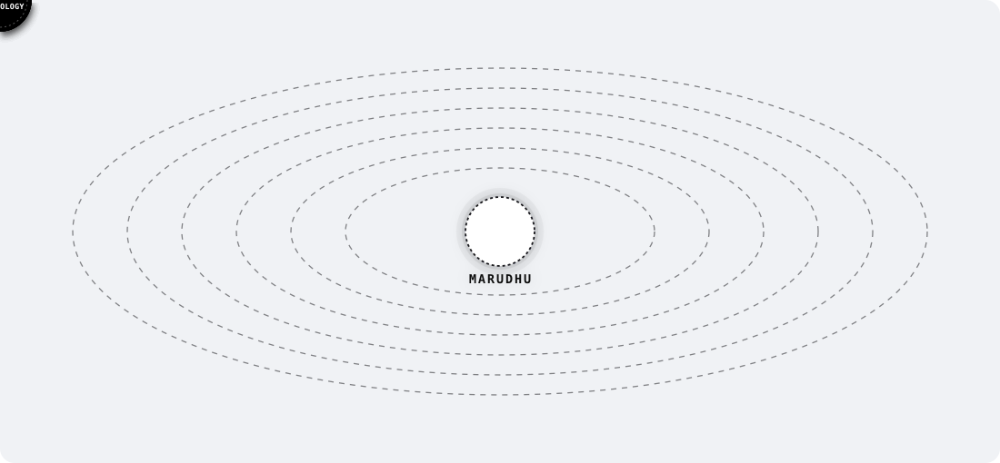

 

<code>THE PERSON BEHIND THE ORBITS</code>

<h1>Hello, I'm Marudhu.</h1>

<em>A curious mind, exploring an ever-expanding universe.</em>

<table width="100%" border="0">
<tr>
<td width="38%" valign="top">

<blockquote>

<em>"This is my little corner of the universe &mdash; a reflection of what fascinates me, what I'm discovering, and where my curiosity takes me."</em>

</blockquote>

<strong>Technical Focus:</strong> 
<code>B.Tech AI &amp; DS</code> &bull; <code>Linux Internals</code> &bull; <code>Systems Programming</code> &bull; <code>Local AI</code>

<strong>Interests in Orbit:</strong>

<ul>
  <li><code>01</code> <strong>Linux</strong> &mdash; <em>Kernel &amp; low-level workflows</em></li>
  <li><code>02</code> <strong>Systems Programming</strong> &mdash; <em>Virtualization &amp; runtimes</em></li>
  <li><code>03</code> <strong>AI</strong> &mdash; <em>Foundations &amp; local inference</em></li>
  <li><code>04</code> <strong>Open Source</strong> &mdash; <em>Shared reproducible craft</em></li>
  <li><code>05</code> <strong>Engineering</strong> &mdash; <em>First-principles problem solving</em></li>
  <li><code>06</code> <strong>Technology</strong> &mdash; <em>Endless curiosity about systems</em></li>
</ul>

<strong>Connect:</strong> 
GitHub: <a href="https://github.com/roninscript30">@roninscript30</a> 
Location: Tamil Nadu, India

</td>
<td width="62%" valign="top">

I'm an <strong>engineering student</strong> with an endless curiosity about technology and the world behind it.

I find myself drawn to <em>understanding how things work</em>, <em>questioning what's possible</em>, and exploring ideas that lead me somewhere unfamiliar.

From the foundations of computing to the evolving world of <strong>artificial intelligence</strong>, I enjoy connecting ideas, experimenting with possibilities, and discovering something new along the way.

I don't have everything figured out, and that's part of the journey. I'm here to <strong>learn deeply</strong>, <strong>think differently</strong>, challenge myself, and keep growing through the things I explore.

 

<table width="100%">
<tr>
<td width="33%" valign="top">
<code>01 // INQUIRY</code> 
<small>Questioning systems beneath the surface &mdash; kernel, hardware, and runtime internals.</small>
</td>
<td width="33%" valign="top">
<code>02 // CREATION</code> 
<small>Building small tools, experimenting with local models, and turning questions into prototypes.</small>
</td>
<td width="33%" valign="top">
<code>03 // EVOLUTION</code> 
<small>Challenging assumptions, seeking depth over hype, and continuous engineering growth.</small>
</td>
</tr>
</table>

<h3><code>Still curious. Still exploring. Always evolving.</code></h3>

</td>
</tr>
</table>
